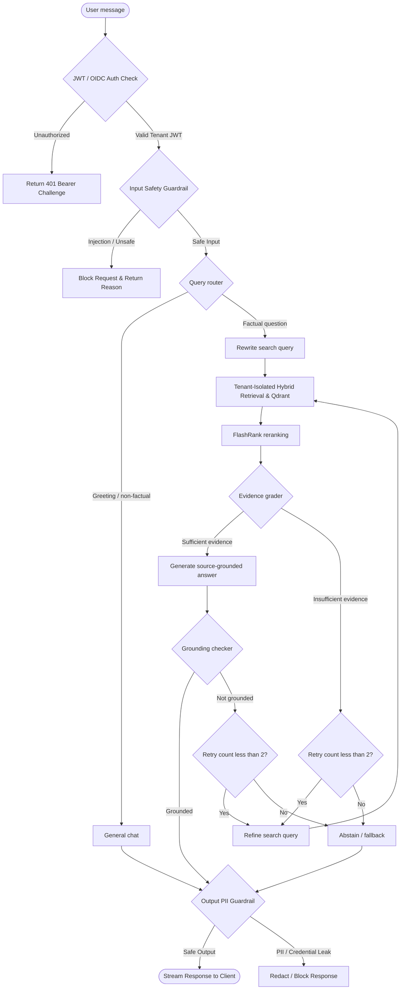

# 🚀 Agentic RAG Workbench

**Release:** v1.3.0

A tenant-aware, enterprise-grade document, media, and website question-answering workbench built with **FastAPI**, **LangGraph**, **Keycloak (OIDC/JWT)**, **Qdrant**, and **Tailwind CSS**. The platform orchestrates stateful multi-node agents that route queries, perform tenant-isolated hybrid retrieval with local reranking, and run corrective grading loops to guarantee grounded, cited responses across diverse LLM providers.

## ✨ Key features

- **Enterprise OIDC/JWT Security (Keycloak):** Production-grade RS256 token verification via `PyJWKClient` enforcing standard claims (`exp`, `iss`, `sub`, `aud`). Dynamically isolates tenant data (`tenant_id`) and user session history with OIDC auth flows and UI token refresh loops.
- **Fail-Closed Security Guardrails:** Regex and LLM-powered prompt injection detection for user inputs, paired with automated PII and credential leak scanning (SSNs, API keys, cards) for model outputs.
- **Multi-Format Ingestion & Smart Re-indexing:** Ingest PDF, TXT, Markdown, DOCX, web pages, and YouTube transcripts with 2,000-char context-preserving chunking. Includes chunk inspection, deletion, and content-hash comparison to skip redundant re-embedding.
- **Multi-Provider LLM Ecosystem:** Seamlessly switch between OpenAI, HuggingFace, Ollama, and OpenAI-compatible vLLM endpoints.
- **Stateful LangGraph & Corrective RAG:** Multi-node agent workflow for query routing, rewriting, evidence grading, answer generation, and grounding checks, with automated retry loops (up to 2 retries) and SQLite thread persistence.
- **Tenant-Isolated Hybrid Search & Reranking:** Qdrant dense semantic + sparse keyword search scoped strictly by `tenant_id`, paired with local **FlashRank** (`ms-marco-MiniLM-L-12-v2`) reranking to isolate top passages.
- **Evaluation & Observability:** Integrated **Ragas** pipeline for evaluating faithfulness and relevance, plus optional **LangSmith** tracing for full graph execution visibility.
- **Real-Time Streaming UI:** Interactive workbench with token-by-token SSE streaming, live agent status indicators, dynamic evidence panel, and chunk inspection tools.

## 🧩 Agent Architecture



## Technology Stack

- **Backend:** Python 3.13+, FastAPI, Uvicorn, PyJWT (`PyJWKClient`)
- **Identity Provider:** Keycloak 24+ (OpenID Connect / OAuth2)
- **Agent Orchestration:** LangGraph, LangChain, SQLite Checkpointer
- **Reranking & Evaluation:** FlashRank (`ms-marco-MiniLM-L-12-v2`), Ragas
- **Vector Storage:** Qdrant (Dense + Sparse Hybrid Search)
- **Model Connectors:** LangChain OpenAI, HuggingFace, Ollama
- **Dependency & Package Manager:** [uv](https://docs.astral.sh/uv/)

## Requirements

- Python 3.13+
- [uv](https://docs.astral.sh/uv/)
- Docker with Docker Compose plugin
- Keycloak Server 24+ (configured with realm `agentic-rag` and client `agentic-rag-backend`)
- OpenAI / Ollama API credentials

---

## Setup & Running

1. **Install dependencies:**
   ```bash
   uv sync
   ```

2. **Configure environment variables:**
   ```bash
   cp .env.example .env
   ```
   Edit `.env` to configure your Keycloak, Qdrant, and LLM provider parameters.

3. **Start Storage & Auth Services:**
   ```bash
   docker compose up -d
   ```
   *(Qdrant Dashboard at `http://localhost:6333/dashboard`; Keycloak Console at `http://localhost:8080/admin/`)*

4. **Launch Application:**
   ```bash
   uv run app.py
   ```
   Access the workbench UI at [http://localhost:8000](http://localhost:8000). Interactive API specs are available at `/docs`.

---

## Configuration Reference

| Variable | Description | Default |
| --- | --- | --- |
| `ENVIRONMENT` | Deployment stage (`development` or `production`) | `production` |
| `AUTH_MODE` | Authentication mode (`oidc` or `development`) | `oidc` |
| `OIDC_ISSUER` | Keycloak realm issuer URL | `http://localhost:8080/realms/agentic-rag` |
| `OIDC_AUDIENCE` | Expected JWT audience claim (`aud`) | `agentic-rag-api` |
| `OIDC_ROLE_CLIENT_ID` | Client ID for role extraction | `agentic-rag-backend` |
| `OIDC_TENANT_CLAIM` | JWT token claim mapping tenant ID | `tenant_id` |
| `DEFAULT_TENANT_ID` | Fallback tenant identifier | `agentic-rag` |
| `OPENAI_API_KEY` | OpenAI API key | None |
| `QDRANT_URL` | Qdrant server endpoint | `http://localhost:6333` |
| `QDRANT_COLLECTION` | Qdrant collection name | `agentic_rag` |
| `DEPLOYMENT_MODE` | Active LLM model provider (`remote`, `openai`, `local`) | `remote` |
| `VLLM_BASE_URL` | vLLM server URL (`remote` mode) | None |
| `VLLM_MODEL_NAME` | Model ID for `remote` mode | `Qwen/Qwen3-32B` |
| `DEV_AUTH_ENABLED` | Enable mock authentication in dev mode | `false` |

---

## API Overview

| Method | Route | Security | Purpose |
| --- | --- | --- | --- |
| `GET` | `/api/sources` | Bearer JWT | List tenant-isolated indexed sources |
| `POST` | `/api/sources/file` | Bearer JWT | Upload and index PDF, TXT, MD, or DOCX documents |
| `POST` | `/api/sources/url` | Bearer JWT | Fetch and index web pages or YouTube transcripts |
| `DELETE` | `/api/sources/{source_id}` | Bearer JWT | Remove a source and its vector payload records |
| `GET` | `/api/sources/{source_id}/chunks` | Bearer JWT | Inspect indexed text chunks for a source |
| `POST` | `/api/sources/{source_id}/reindex` | Bearer JWT | Re-parse and re-index an existing source (skips embedding if unchanged) |
| `POST` | `/api/chat/stream` | Bearer JWT | Stream agent progression and text generation via SSE |
| `POST` | `/api/chat` | Bearer JWT | Direct non-streaming chat endpoint |
| `GET` | `/api/chat/history` | Bearer JWT | Retrieve thread state history for authenticated tenant |

---

## Project Structure

```text
agents/       LangGraph workflow definitions, state models, and agent nodes
ingestion/    Parsers (PDF, DOCX, TXT, MD, Web, YouTube), splitters, and vector indexers
models/       Multi-provider model connectors (OpenAI, HuggingFace, Ollama)
retrieval/    Tenant-isolated hybrid search and FlashRank reranking engine
security/     Keycloak RS256 JWT validation, claims extraction, and fail-closed guardrails
services/     Pipeline orchestration, evaluation (Ragas), and source lifecycle
static/       OIDC-authenticated web application interface and streaming UI
storage/      Qdrant client initialization and SQLite state persistence
app.py        FastAPI application setup, CORS middleware, and API endpoints
config.py     Environment variable schemas and settings management
```

## 🔒 Security & Data Privacy
- **Multi-Tenant Isolation:** All vector search filters, document metadata, and chat checkpoints strictly enforce boundaries using the validated `tenant_id` extracted from the Keycloak JWT.
- **LLM Safety Guardrails:** Every user query passes through pattern and LLM-based prompt injection detection. Model outputs are scanned for PII and credential leaks before client delivery.
- **Provider Choice:** Supports completely air-gapped local setups (`Ollama` + local Qdrant) or cloud endpoints (`OpenAI`).
