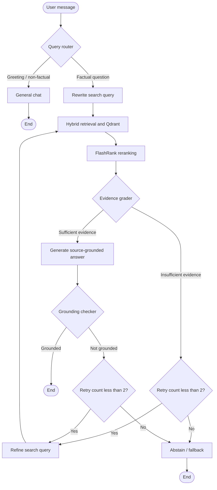

# 🚀 Agentic RAG Workbench

**Release:** v1.2.0

A document and website question-answering workbench built with **FastAPI**, **LangGraph**, **Qdrant**, and **Tailwind CSS**. The workflow uses a stateful multi-node agent that routes queries, performs hybrid retrieval with local reranking, and runs corrective grading loops to ensure generated answers are grounded in your data.

## ✨ Key features

- **Stateful LangGraph Agent:** Explicit workflow handling query routing, query rewriting, hybrid retrieval, evidence grading, answer generation, grounding checks, and graceful abstention. 
- **Corrective Retrieval & Retry Loops:** Inadequate evidence or ungrounded responses automatically trigger a refined search (up to 2 retries) before falling back to an abstention response. SQLite persists chat checkpoints by thread.
- **Multi-Mode Chat Deployments:** Easily switch between `remote` (OpenAI-compatible vLLM), `openai`, or `local` (Ollama) chat models via environment variables.
- **Hybrid Search & Reranking:** Qdrant combines dense semantic and sparse keyword search (retrieving up to 30 candidates); local **FlashRank** (`ms-marco-MiniLM-L-12-v2`) reranks them down to the top 8 passages.
- **Optimized Chunking:** Documents are split into 2,000-character chunks with a 400-character overlap to balance deep context preservation across chunk boundaries.
- **LangSmith Observability:** Optional tracing to inspect full agent runs and individual node executions.
- **Streaming Workbench UI:** Server-sent events (SSE) deliver real-time agent status updates and text generation, filtering internal reasoning tags like `<think>`.
- **Document & Website Ingestion:** Upload PDF/TXT files or index web pages directly via HTTP(S) URLs, with full source inspection and management tools.

## 🧩 Agent architecture



## Technology Stack

- **Backend:** Python 3.13+, FastAPI, Uvicorn
- **Agent & Reranking:** LangGraph, LangSmith (optional), FlashRank (`ms-marco-MiniLM-L-12-v2`)
- **Vector & Data Storage:** Qdrant (dense + sparse vector search), SQLite (source metadata & chat checkpoints)
- **Embeddings:** OpenAI `text-embedding-3-small` (required across all modes)
- **Dependency Management:** [uv](https://docs.astral.sh/uv/)

## Requirements

- Python 3.13+
- [uv](https://docs.astral.sh/uv/getting-started/installation/)
- Docker with Docker Compose plugin
- OpenAI API key (required for embeddings in all modes)

---

## Setup & Running

1. **Install dependencies:**
   ```bash
   uv sync
   ```

2. **Configure environment variables:**
   ```bash
   cp .env.example .env
   ```
   Edit `.env` and set your configuration (see [Configuration Reference](#configuration-reference)).

3. **Start Qdrant:**
   ```bash
   docker compose up -d
   ```
   *(Qdrant UI available at [http://localhost:6333/dashboard](http://localhost:6333/dashboard))*

4. **Start the application:**
   ```bash
   uv run app.py
   ```
   Open [http://localhost:8000](http://localhost:8000) in your browser. API docs are available at `/docs`.

---

## Configuration Reference

| Variable | Description | Default |
| --- | --- | --- |
| `OPENAI_API_KEY` | OpenAI API key (mandatory for embeddings) | None |
| `QDRANT_URL` | Qdrant server URL | `http://localhost:6333` |
| `QDRANT_COLLECTION` | Qdrant collection name | `agentic_rag` |
| `DEPLOYMENT_MODE` | Chat provider: `remote`, `openai`, or `local` | `remote` |
| `VLLM_BASE_URL` | OpenAI-compatible vLLM endpoint (`remote` mode) | None |
| `VLLM_MODEL_NAME` | Chat model name for `remote` mode | `Qwen/Qwen3-32B` |
| `VLLM_API_KEY` | API key for `remote` vLLM endpoint | `your-secure-token` |
| `OPENAI_MODEL_NAME` | Chat model name for `openai` mode | `gpt-4o-mini` |
| `LOCAL_MODEL_NAME` | Ollama model name for `local` mode | `qwen2.5:0.5b` |
| `LANGSMITH_API_KEY` | Optional LangSmith API key for tracing | Not set |
| `LANGCHAIN_TRACING_V2` | Set to `true` to enable LangSmith traces | Not set |
| `LANGCHAIN_PROJECT` | LangSmith project name | Not set |

### Deployment Modes (`DEPLOYMENT_MODE`)
- **`remote` (Default):** Connects to a remote OpenAI-compatible vLLM endpoint (`VLLM_BASE_URL`).
- **`openai`:** Uses native OpenAI models (`OPENAI_MODEL_NAME`).
- **`local`:** Uses local Ollama instance (`LOCAL_MODEL_NAME`). Make sure Ollama is running and the model is downloaded.

---

## API Overview

| Method | Route | Purpose |
| --- | --- | --- |
| `GET` | `/api/sources` | List indexed sources |
| `POST` | `/api/sources/file` | Upload and index a PDF or TXT file |
| `POST` | `/api/sources/url` | Fetch and index a web page |
| `DELETE` | `/api/sources/{source_id}` | Remove a source and its vectors |
| `GET` | `/api/sources/{source_id}/chunks` | Inspect a source's indexed text chunks |
| `POST` | `/api/chat/stream` | Stream agent progression and output via SSE |
| `POST` | `/api/chat` | Non-streaming chat response |
| `GET` | `/api/chat/history` | Read persisted thread history |

---

## Project Structure

```text
agents/       LangGraph workflow, state definitions, and agent nodes
ingestion/    Loaders (PDF/TXT, web), chunking strategies, and indexing
models/       Chat models and embedding client setup
retrieval/    Owner-filtered Qdrant hybrid retrieval
services/     Source lifecycle and pipeline orchestration
static/       Browser-based source workbench and streaming chat UI
storage/      Qdrant setup and SQLite source registry
app.py        FastAPI application and API routing
config.py     Pydantic/Environment configuration management
```

## 🔒 Data & Privacy Note
- **Embeddings via OpenAI:** Regardless of whether your chat model is local (Ollama) or remote (vLLM), text chunk embeddings are generated using OpenAI's `text-embedding-3-small`. Source texts are transmitted to OpenAI.
- **Security Boundary:** The browser-generated owner ID is a convenience feature for workspace separation, **not authentication**. Do not expose this workbench to the public internet without implementing robust authentication and access control.